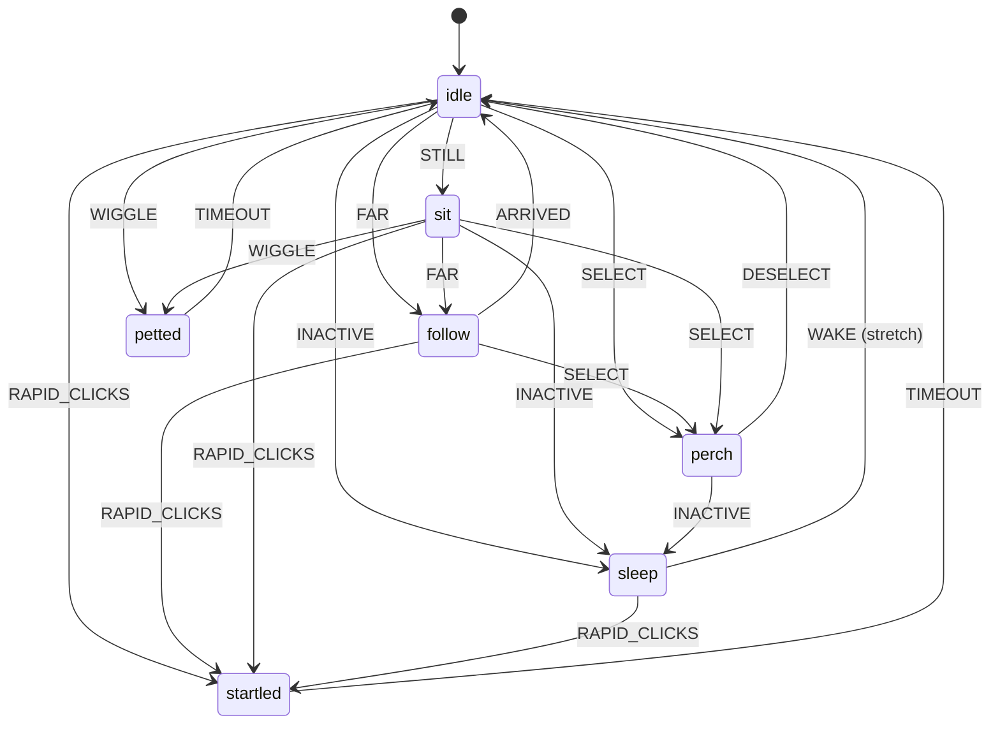

# Pawsor

A round little cartoon puppy that lives on every page you open and follows your cursor around.


> GIF placeholder: record a short clip of Pawsor in action and save it as `docs/media/pawsor-demo.gif`.

## Why I built it

Pawsor is an experiment in UX craft. Most browser extensions exist to get something done. This
one exists to make you smile. I wanted to see how much personality a tiny companion can have
when every detail is considered: a blink at the right moment, a stretch after a nap, a wag
when you say hello. It is a small study in micro-interactions and delight, carried with you
to every page you browse.

## What it does for the user experience

| Behaviour    | What happens                                                                                         | How it feels                                              |
| ------------ | ---------------------------------------------------------------------------------------------------- | --------------------------------------------------------- |
| **Idle**     | Breathes, blinks, twitches an ear and looks toward your cursor                                       | Alive and attentive: someone is keeping you company       |
| **Follow**   | Move far away and it trots after you, faster when you are farther, and stops short of your cursor    | Responsive and loyal, without ever getting in your way    |
| **Sit**      | Rest your cursor for two seconds and it sits down and slowly wags                                    | Patient, like it is waiting for you                       |
| **Sleep**    | Leave it for twelve seconds and it curls up with floating "z z z". Any input wakes it with a stretch | Calm when you are idle; a small reward when you come back |
| **Startled** | Click three times quickly and it jumps, ears up, with a "!"                                          | Playful cause and effect                                  |
| **Perch**    | Highlight some text and it walks over and sits on top of it; clear the selection and it hops off     | Curious about what you are reading                        |
| **Petted**   | Wiggle your cursor back and forth over it for a fast wag, happy eyes, hearts and an optional "boop"  | Pure delight                                              |

### It never gets in your way

- The overlay ignores the mouse entirely, so clicks, typing, scrolling and text selection
  work exactly as they would without Pawsor.
- It stops about 40px from your cursor, so it never covers what you point at.
- It hides while a video or presentation is fullscreen.
- It pauses completely in background tabs.
- You can hide it everywhere with **Alt+Shift+P**, or switch it off on one site from the popup.

### Accessibility

- **Reduced motion**: if your system asks for less motion, Pawsor stops trotting and bouncing.
  It fades out and back in at its new spot, and hearts and bubbles fade in place.
- **Touch screens**: it follows where you tap.
- **Screen readers**: the dog is decorative and hidden from assistive technology.
- **Keyboard**: every control in the popup is reachable with Tab, has a visible focus ring
  and a clear label; coat colours work with the arrow keys.
- **Sound is off by default** and only plays after you have interacted with the page.

## How it works

### Content script and Shadow DOM isolation

A content script runs on every page at `document_idle`. It appends one `<pawsor-host>`
element to the end of `<body>` and attaches a **closed** Shadow Root to it. All dog markup
and CSS live inside, so the page's styles cannot touch the dog and the dog's styles cannot
leak into the page. The host is fixed, full-viewport, `pointer-events: none` and sits on the
top z-index. A guard flag prevents double injection, and if a single-page app wipes the body,
Pawsor quietly re-attaches. Styles are applied with constructable stylesheets, so even pages
with a strict Content Security Policy show the dog correctly.

### Render loop: requestAnimationFrame + lerp

One `requestAnimationFrame` loop drives everything. Each frame reads input first, then
decides, then writes, to avoid layout thrashing. Movement uses frame-rate independent
exponential easing:

```
pos += (target - pos) * (1 - exp(-k * dt))
```

The step is capped by a speed that grows with distance, so the dog sprints when you are far
and eases in gently as it arrives. Delta time is clamped, so returning to a tab never makes
the dog teleport.

### State machine

Behaviour is a hand-written finite state machine. All transitions live in one pure function,
`transition(state, event) → state`, which is unit tested. A second pure function, `sense()`,
turns what the dog perceives each frame (distances, timers, clicks, selection, wiggles) into
an ordered list of events.



### SVG part-based animation

The puppy is a single inline SVG with a separate `<g>` group for the shadow, body, head,
each ear, the eyes, the tail and each of the four legs. The current state is written to a
`data-state` attribute, and CSS keyframes animate the parts: diagonal leg pairs swing in
opposite phase for the trot, the tail wags at different speeds, the ears pop up when
startled. Coat colours are CSS custom properties, and facing left is a `scaleX(-1)` on an
inner wrapper so it never fights the position transform.

### Input handling

All listeners are passive and never cancel page events.

- **Pointer**: position and the time of the last move drive follow, sit and the head turn.
- **Clicks**: recent click times are kept; three within 600ms means a startle.
- **Selection**: `selectionchange` raises a cheap flag, and only then does the loop read the
  first line of the selection. Selections inside form fields are ignored.
- **Wiggle detection**: while the cursor is over the dog, horizontal positions are sampled;
  a pure detector counts direction changes that travel at least a few pixels (so hand
  tremor does not count). Four in a second means petting.
- **Activity**: keys, wheel, scroll and touch keep the dog awake.

### Settings sync through chrome.storage

The popup writes settings to `chrome.storage.sync`. Every open tab listens to
`chrome.storage.onChanged` and updates instantly, without reloads. The keyboard shortcut is
handled by a tiny service worker that flips the same setting. To find out which site the
current tab is on (for "Disable on this site"), the popup asks that tab's content script,
which is why Pawsor needs no permission beyond `storage`.

## Tech stack

| Area        | Choice                                                     |
| ----------- | ---------------------------------------------------------- |
| Platform    | Manifest V3 browser extension (Chrome, Edge, Brave)        |
| Language    | TypeScript (strict), no framework                          |
| Build       | Vite: one IIFE `content.js`, plus popup and service worker |
| Drawing     | Inline SVG with CSS keyframes                              |
| Motion      | `requestAnimationFrame` with lerp easing                   |
| Behaviour   | Hand-written finite state machine                          |
| Sound       | Web Audio API (synthesized, no audio files)                |
| Settings    | `chrome.storage.sync` + `chrome.storage.onChanged`         |
| Shortcut    | `chrome.commands` (Alt+Shift+P)                            |
| Quality     | ESLint, Prettier, `tsc --noEmit`, Vitest + jsdom           |
| Permissions | `storage` only                                             |

## Install

You need Node.js 20 or newer.

```bash
npm install
npm run build
```

Then load the `dist/` folder:

1. Open `chrome://extensions`.
2. Turn on **Developer mode** (top right).
3. Click **Load unpacked** and select the `dist/` folder.
4. Open any website and say hello.

The same steps work in Edge (`edge://extensions`) and Brave (`brave://extensions`).

After changing the code, run `npm run build` again and press the reload button on the
Pawsor card in the extensions page, then refresh the tab you are testing on.

Other scripts: `npm run lint`, `npm run typecheck`, `npm run test`.

## Where it does not run

Browsers do not let extensions run on some pages. Pawsor will not appear there, and the
popup says "Pawsor can't visit this page":

- Browser pages such as `chrome://`, `edge://` and `brave://` (settings, new tab, extensions)
- The Chrome Web Store
- The built-in PDF viewer

This is expected and is how browsers protect those pages.

## Project structure

```
pawsor/
├─ docs/                    PRD, design system, code style, architecture
├─ icons/icon.svg           source drawing for the toolbar icons
├─ public/
│  ├─ manifest.json         Manifest V3
│  └─ icons/                icon-16/32/48/128.png
├─ popup.html               popup markup
├─ scripts/check-build.js   verifies dist/ (single IIFE, storage-only permission)
├─ src/
│  ├─ content/              runs on web pages
│  │  ├─ main.ts            entry: inject once, start the app
│  │  ├─ app.ts             settings, fullscreen, visibility, live updates, teardown
│  │  ├─ host.ts            <pawsor-host> with a closed Shadow Root
│  │  ├─ pawsor.ts          per-frame controller
│  │  ├─ state-machine.ts   pure transition() and sense()
│  │  ├─ motion.ts          lerp, speed, facing, clamping
│  │  ├─ wiggle.ts          petting detector
│  │  ├─ input.ts           passive listeners
│  │  ├─ selection.ts       reads the highlighted line
│  │  ├─ dog-svg.ts         the puppy drawing
│  │  ├─ dog-view.ts        writes state to the DOM, hearts and bubbles
│  │  ├─ audio.ts           synthesized "boop"
│  │  └─ dog.css, shadow.css
│  ├─ popup/                popup logic and styles
│  ├─ background/           service worker for the shortcut
│  ├─ shared/               settings and messages used everywhere
│  └─ test/                 in-memory chrome fake for tests
└─ vite.config.ts           the two builds
```
