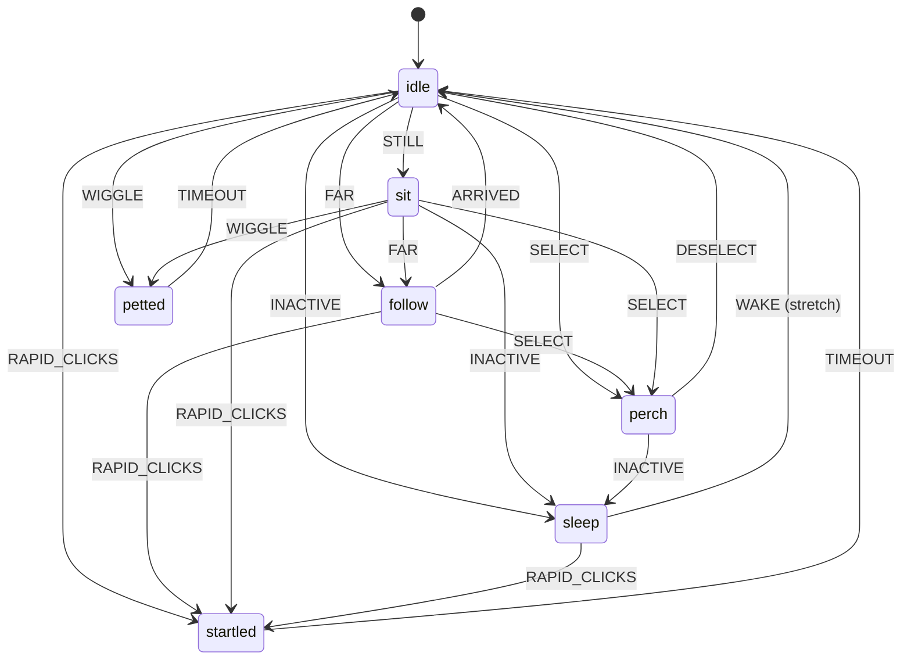

# Pawsor — Architecture

A Manifest V3 extension with three parts: a content script (the dog), a popup (settings)
and a tiny service worker (keyboard shortcut). They talk only through
`chrome.storage.sync` and one popup → tab message. No backend.

## 1. Modules

```
src/
  content/
    main.ts            entry: guard, wait for body, load settings, mount, start
    host.ts            <pawsor-host> + closed Shadow Root + stylesheet adoption
    config.ts          all tuning constants
    state-machine.ts   pure transition(state, event) → state, pure sense()
    motion.ts          pure lerp / speed / clamp / facing math
    wiggle.ts          pure wiggle (petting) detector
    input.ts           passive listeners → InputState
    selection.ts       reads the first line rect of the text selection (never modifies it)
    loop.ts            generic rAF loop with clamped delta time
    pawsor.ts          controller: per-frame tick
    dog-svg.ts         the puppy SVG with named part groups
    dog-view.ts        writes position / facing / data-state; hearts and bubbles
    audio.ts           Web Audio "boop" synth (lazy, gesture-gated)
    dog.css            dog parts and keyframes (imported as a string)
  popup/
    popup.html, popup.ts, popup.css
  background/
    background.ts      chrome.commands → toggle `visible` in storage
  shared/
    settings.ts        Settings type, defaults, pure parse, storage adapter
public/
  manifest.json, icons/icon-{16,32,48,128}.png
icons/icon.svg         source for the PNG icons
```

## 2. Build

Vite runs two builds from `vite.config.ts`:

1. **Content**: library mode, `formats: ['iife']`, entry `src/content/main.ts` →
   `dist/content.js`. CSS is imported with `?inline` so it ships inside the JS.
   Library IIFE mode emits exactly one file. A post-build check fails if the bundle
   contains an `import` statement.
2. **Extension pages**: `popup.html` and `background.ts` → `dist/popup.html`,
   `dist/popup.js`, `dist/background.js` (fixed names, no hashes).

`public/` (manifest, icons) is copied to `dist/` as-is.

## 3. Content script lifecycle

```
document_idle
  └─ main.ts
       ├─ window.__pawsorInjected? → stop (never inject twice)
       ├─ no document.body?        → stop
       ├─ settings = await loadSettings()
       ├─ host = mountHost()        <pawsor-host> appended to <body>, attachShadow({mode:'closed'})
       ├─ view = createDogView(shadowRoot)
       ├─ input = createInput(window)
       ├─ pawsor = createPawsor(view, input)
       ├─ applySettings(settings)   visible && !disabled(hostname) && !fullscreen → start
       └─ storage.onChanged → applySettings (live updates)
```

**Shadow DOM**: closed mode so page scripts cannot reach in. Host styles are set with
`style.setProperty(..., 'important')` because a `style` attribute is blocked by strict CSPs. Styles are adopted with
`new CSSStyleSheet()` + `adoptedStyleSheets` (not blocked by page CSP); if that fails, a
`<style>` element is used. `:host { all: initial }` blocks inherited page styles.

**Never in the way**: the host has `pointer-events: none`. All listeners are on `window`,
`passive: true`, capture phase, and never cancel or stop events.

## 4. State machine

States: `idle`, `follow`, `sit`, `sleep`, `startled`, `perch`, `petted`.

| Event          | Meaning                                                |
| -------------- | ------------------------------------------------------ |
| `FAR`          | Cursor beyond the follow threshold                     |
| `ARRIVED`      | Dog reached its stop point                             |
| `STILL`        | Cursor still for `SIT_AFTER_MS`                        |
| `INACTIVE`     | No input for `SLEEP_AFTER_MS`                          |
| `WAKE`         | Any input while asleep                                 |
| `RAPID_CLICKS` | ≥ 3 clicks within 600ms                                |
| `SELECT`       | Non-empty selection exists (line rect read each frame) |
| `DESELECT`     | Selection cleared                                      |
| `WIGGLE`       | Petting wiggle over the dog                            |
| `TIMEOUT`      | Timed state (`startled`, `petted`) is over             |



`transition(state, event)` is pure. Unlisted pairs return the same object. `sense()` is
also pure: it turns the frame's perception (distances, timers, clicks, selection) into an
ordered list of events. Priority: `startled` > `perch` > `petted` > `sleep` > `follow` >
`sit` > `idle`.

## 5. Render loop and data flow

```
page events ──► input.ts ──► InputState (pointer, last move/input time, clicks, selection)
                                   │
          rAF(t) ──► loop.ts ──► pawsor.ts tick(dt, t):
                                   1. read viewport, selection rect
                                   2. events = sense(state, perception)
                                   3. state  = events.reduce(transition, state)
                                   4. target = f(state, pointer, perch rect)
                                   5. pos    = stepToward(pos, target, dt)  lerp + speed cap
                                   6. pos    = clampToViewport(pos)
                                   7. view.render(...)                      writes only
```

- `pos` is the centre of the dog's 64×56 box in viewport coordinates.
- `dt` is clamped to 50ms; the first frame after a resume has `dt = 0`.
- Lerp: `pos += (target - pos) * (1 - exp(-k·dt))`, capped by a speed that grows with
  distance.
- Paused on `visibilitychange` (hidden), while fullscreen, while hidden by settings and
  on disabled sites.

### Settings data flow

```
 popup ──set()──► chrome.storage.sync ──onChanged──► content script (every tab)
                         ▲                                  │
 background (Alt+Shift+P)┘                                  └─► applySettings()
 popup ──tabs.sendMessage('pawsor:hostname')──► content script ──► { hostname }
```

`Settings = { visible: boolean, coat: 'honey'|'cocoa'|'snow', sound: boolean,
disabledSites: string[] }`, stored under the key `settings`. Parsing is pure and
tolerant: invalid fields fall back to defaults `{ visible: true, coat: 'honey',
sound: false, disabledSites: [] }`; `disabledSites` is de-duplicated and capped at 200.

The popup learns the hostname by messaging the active tab's content script (the `tabs`
permission is not needed for `tabs.query` without URLs or `tabs.sendMessage`). No reply
means Pawsor is not running there.

## 6. Tuning constants (`src/content/config.ts`)

| Constant            | Default |
| ------------------- | ------- |
| `DOG_WIDTH`         | 64 px   |
| `FOLLOW_THRESHOLD`  | 80 px   |
| `STOP_DISTANCE`     | 40 px   |
| `SIT_AFTER_MS`      | 2000    |
| `SLEEP_AFTER_MS`    | 12000   |
| `STARTLE_CLICKS`    | 3       |
| `STARTLE_WINDOW_MS` | 600     |
| `STARTLE_MS`        | 900     |
| `WIGGLE_FLIPS`      | 4       |
| `WIGGLE_WINDOW_MS`  | 1000    |
| `PETTED_MS`         | 1500    |
| `MAX_HEARTS`        | 6       |
| `MAX_DT_MS`         | 50      |

## 7. Failure scenarios

| Scenario                                                           | Behaviour                                                                                 |
| ------------------------------------------------------------------ | ----------------------------------------------------------------------------------------- |
| `chrome://`, `edge://`, `brave://`, Web Store, built-in PDF viewer | Browser blocks content scripts. Expected; the popup shows "Pawsor can't visit this page". |
| No `<body>` (XML, raw SVG)                                         | Content script exits silently.                                                            |
| Script evaluated twice                                             | Guard flag; second run exits.                                                             |
| Page removes the host                                              | Loop checks `host.isConnected` and re-appends it.                                         |
| Strict page CSP                                                    | Constructable stylesheet; `<style>` fallback.                                             |
| Extension reloaded / updated                                       | Old script sees an invalid context, stops the loop, removes the host.                     |
| `chrome.storage` read fails or data corrupt                        | Defaults used; popup shows a small note.                                                  |
| Sync quota exceeded                                                | `disabledSites` capped at 200; write errors are caught.                                   |
| Shortcut taken by another extension                                | Unassigned by the browser; user can set it in the shortcuts page.                         |
| Top-layer elements (`<dialog>`, popovers)                          | They render above the dog. Acceptable.                                                    |
| Fullscreen                                                         | Dog hidden while `document.fullscreenElement` exists.                                     |
| Web Audio unavailable or blocked                                   | Silent; behaviour unchanged.                                                              |

## 8. Key Technical Decisions

### KTD-1: Git permissions

- **Decision**: Commit normally after `lint`, `typecheck`, `test` and `build` pass. Push
  only when the latest message says "push". On "force push", run
  `git push --force-with-lease` to the current branch. On "force commit", commit with
  `git commit --no-verify` even if checks fail, and report which checks failed. Each
  permission applies only to the step in which it was given and never carries over.
- **Context**: The project is built in exactly 15 reviewed commits, and the owner wants
  control over what reaches the shared remote and when.
- **Alternatives**: Push after every commit; push after each phase; never push (owner
  pushes by hand); allow force actions by default.
- **Reason**: Local commits keep a clean, checked history. Explicit, single-use
  permissions keep remote and history-rewriting actions in the owner's hands.

### KTD-2: Closed Shadow DOM host

- **Decision**: One `<pawsor-host>` element with a closed Shadow Root.
- **Context**: The dog runs on arbitrary sites with arbitrary CSS and scripts.
- **Alternatives**: Plain DOM with prefixed classes; an iframe overlay.
- **Reason**: Two-way style isolation with no extra document, cheap to animate, and page
  scripts cannot reach in.

### KTD-3: One IIFE content bundle

- **Decision**: Build the content script as a single IIFE with CSS inlined.
- **Context**: Manifest content scripts are classic scripts; ES module imports fail.
- **Alternatives**: Dynamic `import()` of a web-accessible module (needs
  `web_accessible_resources`); separate CSS file in the manifest (would hit page styles).
- **Reason**: Simplest valid MV3 content script, no extra manifest surface.

### KTD-4: Storage as the message bus

- **Decision**: Popup and background write `chrome.storage.sync`; tabs react via
  `onChanged`.
- **Context**: All open tabs must update live.
- **Alternatives**: `tabs.sendMessage` to every tab (needs the `tabs` permission).
- **Reason**: Works with only the `storage` permission and survives restarts.

### KTD-5: Service worker for the shortcut (pending confirmation)

- **Decision**: A minimal `background.js` listens to `chrome.commands.onCommand` and
  flips `visible`.
- **Context**: Commands are only delivered to extension contexts, not content scripts.
- **Alternatives**: Use `_execute_action` (opens the popup instead of toggling).
- **Reason**: The only way to make Alt+Shift+P a true toggle. See PRD Open Questions.
